<a href="https://ujjwalraj.online"></a>

  
  



<a href="https://github.com/iUjjwalRaj/Maya"></a>

<a href="https://github.com/iUjjwalRaj/RAAHI"></a>

 

<a href="https://github.com/iUjjwalRaj/toxic">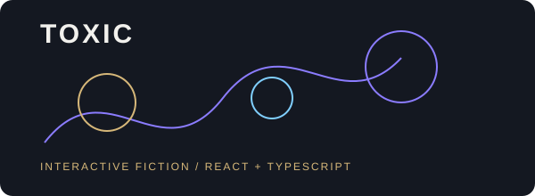</a>

 

<a href="https://github.com/iUjjwalRaj/MusicVideo"></a>

 

<a href="https://github.com/iUjjwalRaj/RONOVA"></a>

 

<a href="https://github.com/iUjjwalRaj/SANGAM">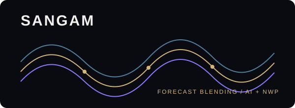</a>

 




  
  

